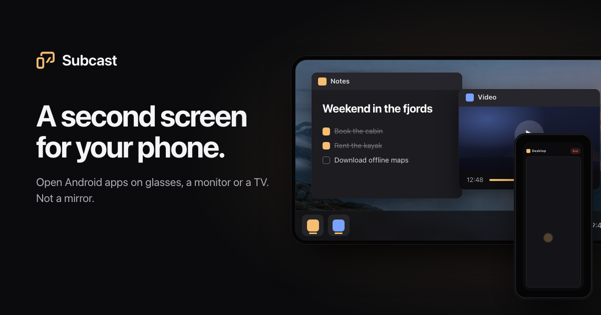

<p align="center">
  <a href="https://getsubcast.com"></a>
</p>

<p align="center">
  <a href="https://github.com/subcast/subcast/releases/latest"></a>
  <a href="https://github.com/subcast/subcast/releases"></a>
  
  
</p>

<p align="center">
  <a href="https://github.com/subcast/subcast/releases/latest/download/Subcast.apk"><b>Download the APK</b></a>
  &nbsp;·&nbsp;
  <a href="https://getsubcast.com">Website</a>
  &nbsp;·&nbsp;
  <a href="https://getsubcast.com/guide">Guide</a>
  &nbsp;·&nbsp;
  <a href="mailto:support@getsubcast.com">Support</a>
</p>

---

**Subcast opens your Android apps on display glasses, a monitor or a TV**, full size at the display's own resolution, not as a blurry phone mirror boxed in black bars. Your phone becomes the trackpad.

## What it does

- **Wear it**. Plug in USB-C display glasses and your apps float in front of you. Black is see-through on glasses, so the dock and windows hang in the air.
- **A real desktop**. Move, resize, minimize and maximize apps. Switch from the taskbar or with Alt+Tab. Apps reopen if the display disconnects.
- **Your phone is the trackpad**. Slide to move the pointer, tap to click, hold and slide to drag. Scroll along the right edge or with two fingers.
- **Or just point**. Turn on the laser pointer and aim your phone at the screen. The pointer follows.
- **Type anywhere**. Your phone's keyboard types into the app on the display, or connect a Bluetooth or USB keyboard and mouse.
- **One app, the whole screen**. Cast a single app full screen and it gets the display's width, so wide layouts use it.
- **Phone screen off**. One tap turns the phone screen off while the display keeps going, saving battery.
- **Glasses, monitors and TVs**. USB-C glasses and monitors, or a TV on your Wi-Fi (Miracast and cast-ready TVs).

## Get started

1. **Install Subcast.** Download [`Subcast.apk`](https://github.com/subcast/subcast/releases/latest/download/Subcast.apk) on your phone and open it. Allow installing from your browser or file manager if Android asks.
2. **Turn on [Shizuku](https://shizuku.rikka.app).** It's a free, open-source helper that gives Subcast the access Android keeps for system tools, without root. Subcast walks you through it.
3. **Connect a display** and tap an app, or open the desktop.

**Needs** Android 14 or newer, and a USB-C port with video output (DisplayPort Alt Mode) for wired displays. Tested with the VITURE Beast.

## Free and Pro

Every feature is free. Free casts last up to 10 minutes, then take a 3-minute break; stopping early keeps the time you didn't use.

[**Subcast Pro**](https://getsubcast.com/#pricing) removes the limit: **$9.99 once**, no subscription, no account. Unlock it in the app from **⋯ › Subcast Pro**.

## Privacy

Video goes straight from your phone over the cable or your own Wi-Fi. No analytics, no ads, no accounts. See the [privacy policy](https://getsubcast.com/privacy).

## Verify your download

Each release lists the APK's SHA-256. Every Subcast APK is signed with the same certificate:

```
36:A9:FF:99:81:00:28:1C:7B:F7:86:53:3F:33:DE:1A:B4:80:96:C3:C8:18:E2:01:06:1A:3F:7C:E7:63:E2:37
```

Check it with `apksigner verify --print-certs Subcast.apk`.

## Help

Read the [guide](https://getsubcast.com/guide) and the [FAQ](https://getsubcast.com/#faq). Found a bug? [Open an issue](https://github.com/subcast/subcast/issues/new/choose) or email [support@getsubcast.com](mailto:support@getsubcast.com).

---

<p align="center"><sub>This repository hosts Subcast's releases. Subcast is not affiliated with Google or any display maker.</sub></p>
